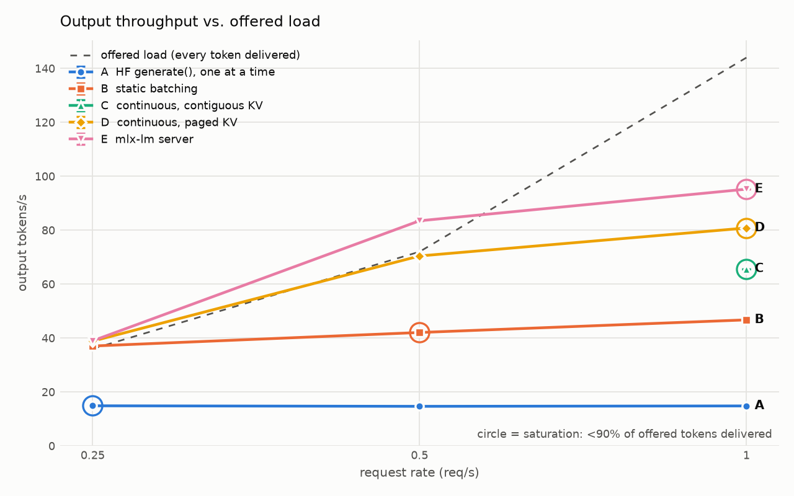
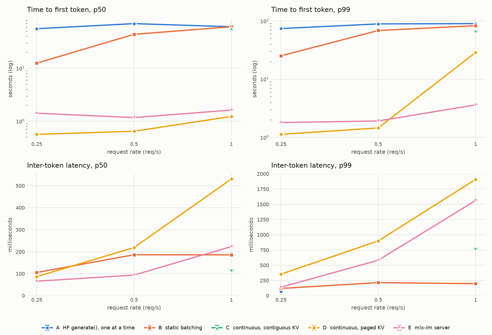
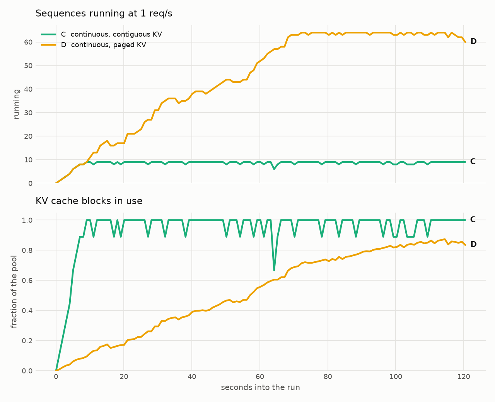
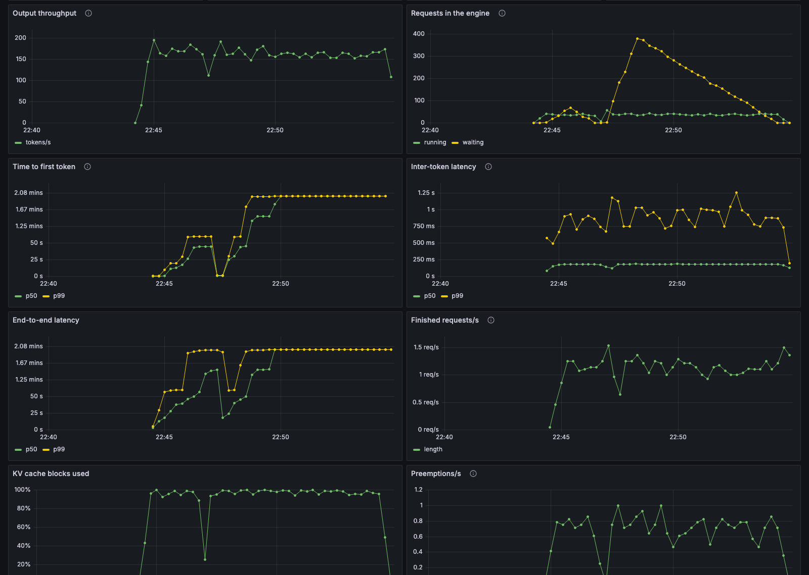

# tinyserve

An LLM inference server built from scratch in PyTorch, serving Llama 3.2.

## Results

Llama 3.2 3B Instruct on a MacBook Air M4 (24 GB), same model and streamed Poisson workload for every config (prompts ~50–300 tokens, outputs 32–256). 2 GB of KV cache for tinyserve's continuous-batching configs.

| Config | Output tok/s @ 1 req/s | TTFT p50 @ 0.5 req/s | Max concurrent sequences |
|---|---|---|---|
| A · HuggingFace `generate()`, one at a time | 14.8 | ≥ 70 s | 1 |
| B · tinyserve, static batching | 46.7 | ≥ 44 s | 16 |
| C · tinyserve, continuous batching, contiguous KV | 65.7 | – | 9 |
| **D · tinyserve, continuous batching, paged KV** | **80.8** | **0.64 s** | **64** |
| E · mlx-lm server (Apple MLX, reference) | 95.2 | 1.17 s | – |

- Paged continuous batching delivers **5.5×** the throughput of naive HuggingFace serving and **1.7×** static batching, at **85%** of mlx-lm.
- In the same 2 GB, the paged cache runs **7× more sequences** than a contiguous one (64 vs. 9), and **23%** more throughput.
- Past saturation, D admits everyone and slows every stream (ITL p50 531 ms at 1 req/s) instead of making requests queue.





Single runs per point (60 s measured after 30 s warmup), so treat differences under ~10% as noise. "≥" marks TTFTs that are lower bounds: some requests were still waiting for their first token when the run was cut off. mlx-lm runs bf16 with its prompt cache; tinyserve runs fp16 without one. Full table, raw CSVs, commands and hardware: [`benchmarks/results/llama-3.2-3b/`](benchmarks/results/llama-3.2-3b/).

```bash
uv run python benchmarks/run_matrix.py --rates 0.25 0.5 1 --runs 1 --out benchmarks/results/llama-3.2-3b
uv run python benchmarks/plot.py benchmarks/results/llama-3.2-3b
```

## Setup

```bash
uv sync
hf auth login   # Llama 3.2 is gated: request access at huggingface.co/meta-llama/Llama-3.2-1B-Instruct first
```

## Serve

```bash
uv run python -m tinyserve            # OpenAI-compatible API on localhost:8000, streaming + /metrics
```

```python
from openai import OpenAI

client = OpenAI(base_url="http://localhost:8000/v1", api_key="unused")
client.chat.completions.create(model="llama", messages=[{"role": "user", "content": "Hi!"}])
```

## Monitor

```bash
docker compose -f deploy/docker-compose.monitoring.yml up -d   # Grafana on localhost:3000
uv run python benchmarks/load_gen.py --rate 2 --duration 60      # Poisson load, streamed
```



*Llama 3.2 1B (fp16, MacBook Air M4) with a deliberately small 0.25 GB KV cache, under streamed Poisson load: 2 req/s then 6 req/s for 90 s each (prompts 20–200 words, outputs 32–256 tokens). Throughput saturates at ~165 tokens/s, so the queue grows and TTFT climbs, while the full KV cache causes steady preemptions. All 705 requests completed.*

## Generate

```bash
uv run python benchmarks/single_request.py "Explain what a KV cache is."
```

## Tests

```bash
uv run pytest            # fast: tiny random-weight Llama vs HuggingFace
uv run pytest -m slow    # real Llama 3.2 1B vs HuggingFace (downloads ~2.5GB)
```
